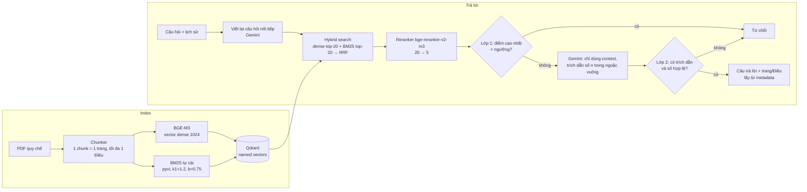

# Chatbot RAG hỏi đáp quy chế đào tạo

Chatbot trả lời bằng tiếng Việt các câu hỏi về **Thông tư 08/2021/TT-BGDĐT** (quy chế đào tạo đại học của Bộ GD&ĐT) và
**Quy chế đào tạo ĐH Bách khoa Hà Nội 2025**. Mỗi câu trả lời kèm trích dẫn **file / trang / Điều**. Khi tài liệu không
có thông tin, chatbot trả đúng một câu: `Không tìm thấy thông tin trong tài liệu quy chế.`

Dự án cá nhân, làm để học và trình bày cách xây một hệ RAG có đo đạc: mọi lựa chọn chính (chunk, ngưỡng từ chối,
có rerank hay không) đều được chọn bằng số liệu trên tập dev và báo cáo trên tập test riêng.

## Kiến trúc



Thành phần: `src/ingestion` (chunker, BM25, embedder, indexer), `src/retrieval` (hybrid search, reranker),
`src/rag` (prompt, LLM, viết lại câu hỏi, pipeline), `src/api` (FastAPI `/chat`, `/health`), `src/ui` (Streamlit),
`eval/` (bộ câu hỏi và các script đánh giá).

## Quyết định thiết kế (và vì sao)

| Quyết định | Lý do |
|---|---|
| **Hybrid: BGE-M3 (dense) + BM25 tự cài, gộp bằng RRF** | Dense hiểu cách nói đời thường ("bị đuổi học"), BM25 bắt đúng thuật ngữ và con số. Trên test, hybrid tăng Recall@5 từ 0,850 lên 0,900. Tự cài BM25 (thay vì thư viện trọn gói) để giải thích được từng bước và đo riêng từng tầng. |
| **BM25: phần tf/độ dài tính ở client, IDF để Qdrant tính** (`Modifier.IDF`) | Qdrant chỉ hỗ trợ IDF phía server; phần còn lại có test so với công thức tham chiếu, để không gọi nhầm "tf × IDF" là BM25. |
| **Reranker cross-encoder 20 → 5** | Tăng Recall@5 trên test từ 0,900 lên 0,917 và MRR@5 từ 0,768 lên 0,787. Chạy GPU float16 (RTX 3050 Ti 4 GB): rerank 0,3–0,9 s thay vì ~14 s trên CPU. |
| **Số trang lấy từ metadata, không từ LLM** | LLM chỉ được trích số `[n]`; code ánh xạ `[n]` → file/trang/Điều. LLM không thể bịa số trang. |
| **Hai lớp chống bịa** | Lớp 1: điểm rerank quá thấp thì từ chối, không tốn lời gọi LLM. Lớp 2: câu trả lời không trích dẫn hoặc trích số không tồn tại thì từ chối. |
| **`chunk_size` 1200 ký tự, overlap 200** | Chọn bằng Recall@5 (Hybrid + Rerank) trên dev, xem bảng dưới. |
| **Ngưỡng rerank 0,02** | Ngưỡng lớn nhất có tỉ lệ từ chối nhầm ≤ 10% trên dev. Ngưỡng khởi đầu 0,3 từ chối nhầm 15% câu hỏi hợp lệ. |
| **Mọi thành phần nặng sau một Protocol** | Test dùng bản giả: 329 test chạy trong ~1 phút, không tải model, không gọi mạng. |
| **Qdrant chạy Docker** | Local mode khóa file, API + indexer + đánh giá không chạy cùng lúc được. |

## Kết quả đánh giá

**Dữ liệu** (`eval/data/`, chi tiết nguồn gốc trong `eval/data/README.md`): 100 câu hỏi (70 test, 30 dev; 14 câu
ngoài phạm vi) và 15 hội thoại nhiều lượt. **Câu hỏi và nhãn do AI (Gemini) soạn nháp, được kiểm tra tự động và
người làm dự án duyệt; nhãn chưa đối chiếu từng câu với PDF gốc.** Một chunk được tính là "trúng" khi cùng file, cùng
số Điều và trang nằm trong nhãn.

Cấu hình: `BAAI/bge-m3`, `BAAI/bge-reranker-v2-m3` (float16, CUDA), `gemini-3.5-flash-lite`; commit `acdd371`;
ngày 2026-11-08. File JSON gốc trong `eval/reports/`.

### Chọn `chunk_size` (split dev, 26 câu trong phạm vi)

| chunk / overlap | Số chunk | Recall@5 hybrid | Recall@5 hybrid + rerank | MRR@5 hybrid + rerank |
|---|---|---|---|---|
| 400 / 80 | 467 | 0,846 | 0,885 | 0,787 |
| 800 / 150 | 225 | 0,865 | 0,865 | 0,808 |
| **1200 / 200** | 169 | 0,865 | **0,904** | **0,811** |

Recall@20 bằng nhau (0,923) ở cả ba. Chênh lệch giữa các cấu hình chỉ tương đương 0,5–1 câu trên 26 câu: 1200 được
chọn theo quy tắc đặt trước (Recall@5 cao nhất), không phải bằng chứng chắc chắn là tốt hơn.

### Chọn ngưỡng rerank (split dev, chỉ lớp 1, không gọi LLM)

| Ngưỡng | 0,01 | **0,02** | 0,05 | 0,1 | 0,3 | 0,6 |
|---|---|---|---|---|---|---|
| Từ chối đúng (4 câu ngoài phạm vi) | 0,50 | **0,75** | 0,75 | 1,00 | 1,00 | 1,00 |
| Từ chối nhầm (26 câu trong phạm vi) | 0,038 | **0,077** | 0,154 | 0,154 | 0,154 | 0,231 |

Câu ngoài phạm vi lọt qua lớp 1 vẫn có thể bị lớp 2 (LLM) từ chối; kết quả trên test bên dưới xác nhận điều đó.

### Báo cáo cuối (split test, 70 câu, chỉ chạy một lần với cấu hình đã chốt)

Truy xuất (60 câu trong phạm vi):

| Cấu hình | Recall@5 | Recall@20 | MRR@5 |
|---|---|---|---|
| Dense (BGE-M3) | 0,850 | 0,942 | 0,718 |
| Hybrid (dense + BM25, RRF) | 0,900 | 0,950 | 0,768 |
| **Hybrid + Rerank** | **0,917** | — | **0,787** |

Câu trả lời (pipeline đầy đủ, ngưỡng 0,02):

| Chỉ số | Kết quả |
|---|---|
| Từ chối đúng câu ngoài phạm vi | **10/10** (1,00) |
| Từ chối nhầm câu trong phạm vi | 5/60 (0,083) |
| Trích dẫn trúng nhãn (trong các câu được trả lời) | 50/55 (0,909) |
| Lỗi LLM | 0 |

Viết lại câu hỏi nối tiếp (15 hội thoại): Recall@5 với câu độc lập viết tay **0,967**. Với câu do LLM viết lại,
hai lần chạy cho **0,900** và **0,967** (LLM không tất định), tức bước viết lại làm mất 0–1 hội thoại trên 15; không
lần nào lỗi. File JSON chỉ có lần chạy thứ hai (commit `75a9ac5`); lần đầu chưa lưu báo cáo.

Báo cáo truy xuất, ngưỡng và câu trả lời ghi commit `acdd371` nhưng chạy trên cây có thay đổi chưa commit; các thay đổi
đó (giá trị mặc định, tham số `--delay`) không ảnh hưởng số liệu vì cấu hình được truyền qua biến môi trường.

## Cài đặt

Yêu cầu: Windows, Python **3.11**, Docker Desktop, khóa API Gemini. GPU NVIDIA (CUDA) không bắt buộc nhưng nhanh
hơn ~10 lần.

```powershell
py -3.11 -m venv .venv
.venv\Scripts\python -m pip install -r requirements.lock
copy .env.example .env          # rồi điền GEMINI_API_KEY, GEMINI_MODEL
docker compose up -d            # Qdrant tại 127.0.0.1:6333
```

`requirements.lock` ghim bản torch CUDA (`2.15.0+cu132`); máy không có GPU NVIDIA cần cài torch bản CPU thay thế.

## Chạy

```powershell
.venv\Scripts\python -m src.ingestion.indexer --pdf-dir data/pdfs     # index PDF (không commit PDF)
powershell -ExecutionPolicy Bypass -File chatbot.ps1 start            # Qdrant + API :8000 + giao diện :8502
powershell -ExecutionPolicy Bypass -File chatbot.ps1 stop             # tắt hết, trả GPU
```

Giao diện: http://localhost:8502. API: `POST http://127.0.0.1:8000/chat` với `{"question": "...", "history": []}`.

## Test và đánh giá

```powershell
.venv\Scripts\python -m pytest                     # 329 test nhanh, dùng bản giả
.venv\Scripts\python -m pytest -m slow             # cần model đã tải và Docker
.venv\Scripts\python -m eval.evaluate_retrieval --split dev
.venv\Scripts\python -m eval.evaluate_answers --split dev --sweep 0.01,0.02,0.05,0.1,0.3
.venv\Scripts\python -m eval.evaluate_answers --split test --delay 6   # --delay tránh lỗi 429 của Gemini
.venv\Scripts\python -m eval.evaluate_rewrite
```

Chỉ chỉnh tham số dựa trên split `dev`; split `test` chỉ dùng để báo cáo.

## Hạn chế đã biết

- Bộ đánh giá do AI soạn và chỉ một người duyệt; nhãn chưa đối chiếu với PDF gốc. Tập nhỏ (dev chỉ có 4 câu ngoài
  phạm vi), nên các khác biệt dưới ~0,04 không có ý nghĩa thống kê.
- PDF scan (không có lớp chữ) bị bỏ qua: chưa có OCR. Ví dụ quy chế của Trường ĐH Phenikaa trên trang trường đều là
  bản scan nên chưa dùng được.
- File quy chế HUST trên trang trường để trống số và ngày quyết định (tên file ghi số 5445); có thể khác bản ký.
- Hai văn bản có nhiều quy định giống nhau; chatbot có thể trích Thông tư 08 khi người hỏi muốn quy định riêng của HUST.
- Gemini bản miễn phí giới hạn số lần gọi mỗi phút; khi quá giới hạn, API trả 503 kèm nguồn đã tìm được.
- Indexer luôn xử lý cả thư mục; chỉ định sai `--pdf-dir` sẽ xóa point của các file không có trong thư mục đó.
